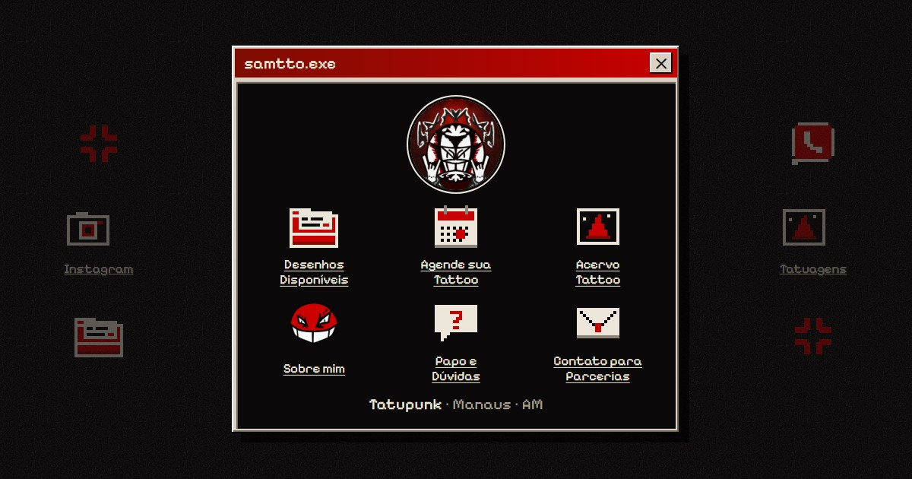

  

<h1 align="center">Samtto · Tatuador em Manaus</h1>

  <strong>Tatupunk · ignorant style · neotribal · arte underground</strong> 
  <a href="https://samtto.com.br">samtto.com.br</a> ·
  <a href="https://www.instagram.com/ssamtto/">Instagram @ssamtto</a> ·
  <a href="https://www.tiktok.com/@ssamttoo">TikTok @ssamttoo</a> ·
  <a href="https://wa.me/5592994075239">WhatsApp (92) 99407-5239</a> ·
  <a href="mailto:samuelsidneyinfo@gmail.com">samuelsidneyinfo@gmail.com</a>

---

**Samtto** é artista, tatuador e ilustrador em **Manaus (AM)**. Faz *tatupunk*: traço sujo, vermelho e preto, máscara, caveira, arame e tribal pontudo. Atende no **Estúdio Maniva**, estúdio privado de tatuagem autoral. Comissões abertas para tatuagem, ilustração, quadro e estampa.

## No site

| Página | O que tem |
|---|---|
| [Início](https://samtto.com.br/) | Desktop com os atalhos do site |
| [Desenhos disponíveis](https://samtto.com.br/disponiveis.html) | Flashes prontos para tatuar, com reserva pelo WhatsApp |
| [Agende sua tattoo](https://samtto.com.br/orcamento.html) | Formulário que monta a mensagem e abre o WhatsApp |
| [Acervo de tattoos](https://samtto.com.br/portfolio.html) | Tatuagens separadas em flashs, encomendas e freehands |
| [Sobre](https://samtto.com.br/sobre.html) | Quem é, estilo e onde tatua |
| [Papo e dúvidas](https://samtto.com.br/papo.html) | Como agendar, valores, sinal, pagamento e cuidados |

## Agendar

Valores: flashs de R$ 200 a 500, encomendas de R$ 300 a 500, projetos grandes de R$ 600 a 1.000 (mínimo R$ 200). Sinal de R$ 50 garante a reserva por 1 mês. Atendimento das 10h às 22h.

Pelo [formulário do site](https://samtto.com.br/orcamento.html), pelo [WhatsApp](https://wa.me/5592994075239) ou por DM no [Instagram](https://www.instagram.com/ssamtto/). Manda a ideia, o lugar do corpo e o tamanho.

## Sobre o site

Site estático (HTML, CSS e JavaScript, sem framework), publicado pelo GitHub Pages no domínio próprio. Visual de "desktop" com ícones em pixel art desenhados para o Samtto, janelas no estilo Windows 98 e a paleta dele: tinta, papel e vermelho.

As imagens das tatuagens e a identidade visual são do Samtto. Não reutilize sem autorização.

---

Site por <a href="https://lrgz.com.br">L R G Z</a>

